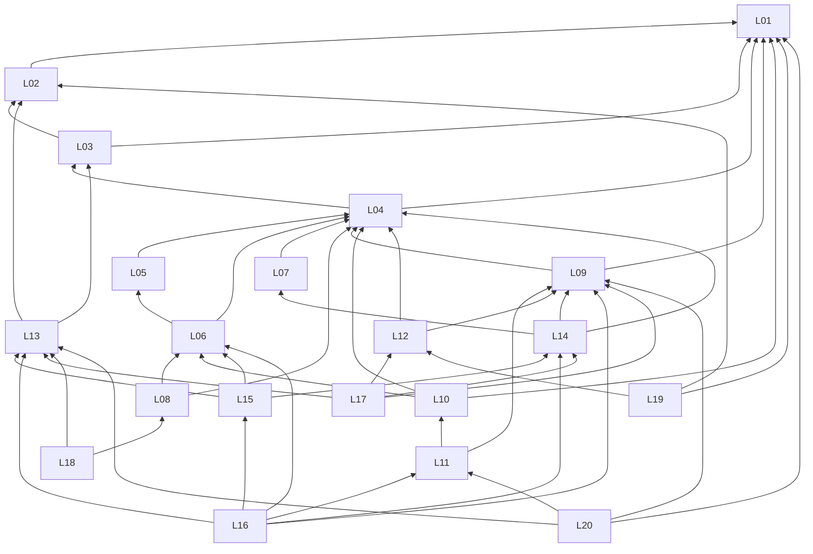

# Global AI Engineering Operating System

The owner's official target is a shared engineering control plane with independent
product repositories, data, permissions and production runtimes. The hub provides
reviewed capabilities during development/build; its availability is never a product
runtime dependency. Preserve the existing modular implementation and API contracts.
Use a modular monolith first. Distributed services, Kubernetes and paid/GPU services
require measured need, actual capacity and budget authorization.

The architecture has twenty layers. L01–L12 are the original twelve; L13–L20 extend them
over modules that already exist in this tree. The machine-readable registry is
`governance/layers.json` (contract: `docs/specs/gaie-20-layers/CONTRACTS.md`); the
per-layer specification is `docs/specs/gaie-20-layers/LAYERS.md`.

| Layer | Target responsibility | Current evidence boundary |
|---|---|---|
|L01 Owner, Policy & Governance|Access, policy, budget, approvals, audit|Local policy/receipt validators; provider administration is separate|
|L02 AI Intelligence & Model Routing|Models, routing, evaluation|Deterministic policy routing; actual model access must be evidenced|
|L03 Adaptive Agent Orchestration|Specialist ownership, priorities, handovers|Explicit invocations/file-state coordination; no continuous daemon claim|
|L04 Engineering Control Plane|Registries, SDK, knowledge, discovery|Existing CLI, checksummed SDK and additive operational commands|
|L05 Universal Integration Intelligence|MCP,A2A,ACP,REST,GraphQL,webhooks,CLI,events|Local MCP/CLI implemented; other protocols remain per-adapter candidates|
|L06 Software Engineering|Web/backend/mobile/enterprise/SaaS/reuse|Existing shared skills; project implementations remain private|
|L07 Data & Knowledge Intelligence|SQL,RLS,RAG,vectors,analytics,ML|No shared production database provisioned; project-level verification required|
|L08 Cinematic, Motion & GPU|Browser,GPU,3D,video,motion,spatial|Preserve verified CSS/WAAPI/WebGL; new engines need their own runtime proof|
|L09 Security & Quality Intelligence|Threat boundaries,scans,tests,budgets|SHA-pinned CI and test/audit evidence; no blanket compliance claim|
|L10 Independent Product Ecosystem|Eight current spokes and future products|Private registry outside public Git; local preparation differs from remote completion|
|L11 Cloud & Deployment Intelligence|Independent environments,CI/CD,preview,rollback|Existing provider projects preserved; incomplete permissions block relinking|
|L12 Continuous Technology Intelligence|Technology/dependency/security/cost/health discovery|Read-only discovery and reviewed update proposals; no automatic execution|
|L13 Advanced Engineering Reasoning|Constraint planning, decision review, root-cause ranking|Deterministic ranking of supplied alternatives and schedules; no model reasoning or inferred causality|
|L14 Persistent Engineering Memory|Project knowledge, decisions, failures, checkpoints|Private file-backed memory outside Git; lexical retrieval, not embeddings; checksums detect corruption only|
|L15 Requirements & Specification Intelligence|Owner commands to clauses, targets and acceptance traces|Deterministic command parsing and bounded request validation; engineering_os/requirements.py is wave 2|
|L16 Autonomous Software Factory|Artifact lifecycle gates from plan to verified release|Plans and checks artifacts against supplied receipts; generates no complete application and deploys nothing|
|L17 Self-Healing & Recovery Intelligence|Diagnosis, repair proposals, repair verification|Repair proposals and fixed declarative checks; candidate code is never executed|
|L18 Advanced Cinematic Intelligence|Original-motion proof, selection, engine-native motions|Source-bound inventory and engine-motion resolution; every render needs its own browser receipt|
|L19 Engineering Economics & Resource Intelligence|Usage, cost, quota and context budgets|Offline accounting over supplied ledgers; tokens, cost and subscription quota stay separate|
|L20 Independent Engineering Assurance|Source-bound evidence, independent review, release provenance|Source-bound test receipts; engineering_os/assurance.py is not yet integrated; hashes do not authenticate reviewers|

Dependencies (`depends_on` in the registry; an arrow points from a layer to a layer it
uses; the graph is acyclic and every edge points to an earlier layer):



The same graph by depth (a layer sits one tier above its deepest dependency):

```
tier 8   L16 factory ........... L06 L09 L11 L13 L14 L15    L20 assurance .... L01 L09 L11 L13
tier 7   L11 cloud ............. L09 L10                    L18 cinematic+ ... L08 L13
tier 6   L08 motion/GPU ........ L04 L06                    L10 products ..... L01 L04 L06
         L15 requirements ...... L06 L13 L14                L17 healing ...... L09 L12 L13 L14
         L19 economics ......... L01 L02 L12
tier 5   L06 software .......... L04 L05                    L12 tech intel ... L04 L09
         L14 memory ............ L04 L07 L09
tier 4   L05 integrations ...... L04                        L07 knowledge .... L04
         L09 security .......... L01 L04
tier 3   L04 control plane ..... L01 L03                    L13 reasoning .... L02 L03
tier 2   L03 orchestration ..... L01 L02
tier 1   L02 model routing ..... L01
tier 0   L01 owner, policy & governance
```

Evidence: a layer is never complete because a name, a file or a document exists.
`python3 hub.py layers` prints each layer's status from its latest receipt (UNVERIFIED
when there is none or it no longer matches the files). `python3 hub.py layers --verify
[--layer Lxx] [--state DIR]` runs every test the layer lists in a fresh subprocess and
writes a receipt, in a private state directory outside Git, bound to the SHA-256 of the
layer record, its tests and every in-tree source they imported; editing any of them
withdraws VERIFIED. Node tests are reported as skipped, never as passed, when node is
missing.

`python3 hub.py architecture` reports these twenty layers and their evidence mapping;
L01–L12 keep every field of the twelve-layer projection (`engineering_os.control:architecture`).
`capabilities`, `integrations`, `motions` and `health` report their own tested
surfaces rather than treating catalog names as installed tools. Operational counts
require receipts tied to current source checksums and actual test results.

Lifecycle:DISCOVERED→REVIEWED→APPROVED→INSTALLED→OPERATIONAL→TESTED→PROJECT_VERIFIED.
Review upstream identity, immutable revision, license/commercial use, security,
dependency compatibility, privacy and cost before advancing. A protocol handshake
is not an agent-host invocation; API presence is not a successful GPU render;
simulated tests are not live data/provider evidence. Details live in the versioned
spec and capability records. Keep confidential inventories out of this public hub.

Existing reference architecture remains in docs/ARCHITECTURE.md. Existing imports,
motion catalog and SDK1.0.0 remain supported; new package facades are additive.
